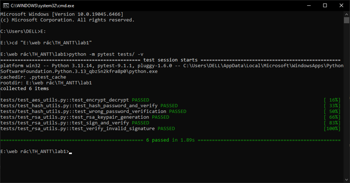
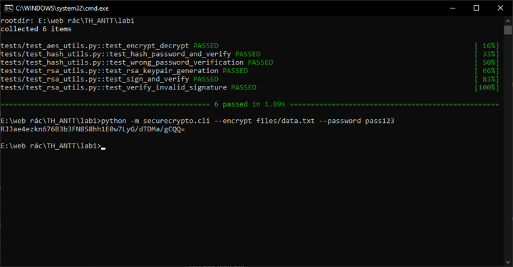
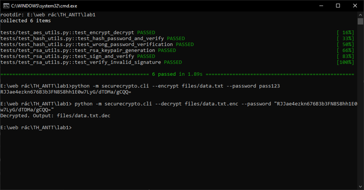
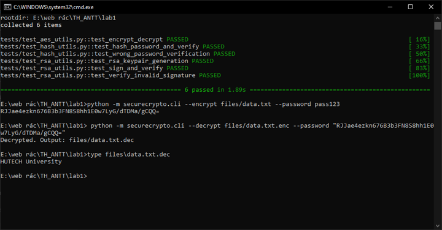
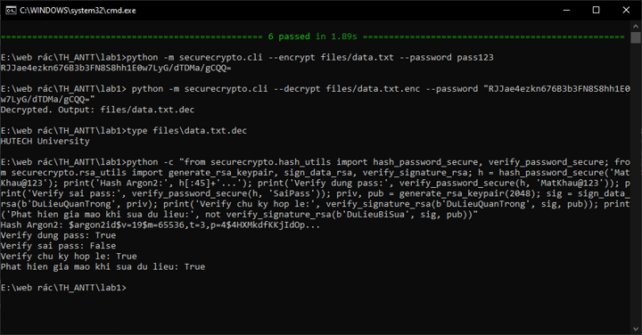
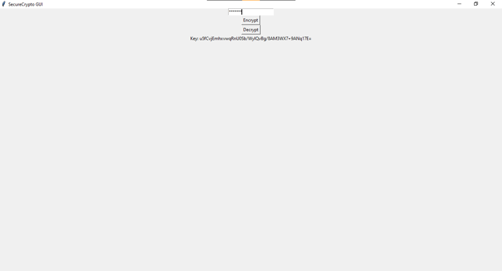
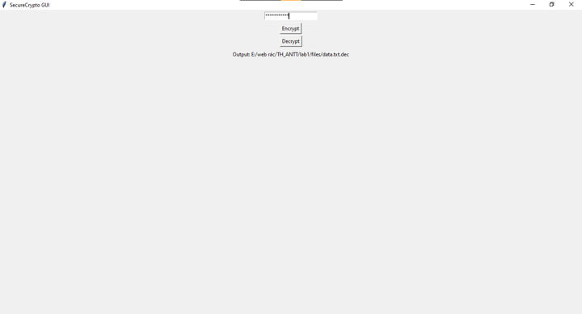
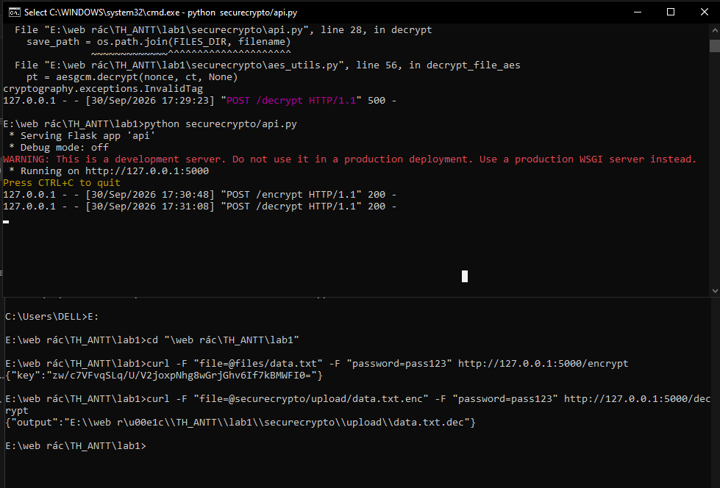

# 📑 BÁO CÁO THỰC HÀNH LAB 1: CRYPTO TOOLKIT (SECURECRYPTO)

---

## 👤 Thông tin sinh viên
- **Họ và tên:** Phạm Nguyễn Minh Sơn
- **Mã số sinh viên (MSSV):** 2387700057
- **Lớp:** 23DATA1
- **Môn học:** Thực hành Lập trình An ninh thông tin
- **Bài thực hành:** Bài 2 - Lab 1: Xây dựng thư viện mật mã SecureCrypto

---

## 🎯 Mục tiêu bài thực hành
1. Xây dựng và kiểm thử các thuật toán mã hoá đối xứng hiện đại (**AES-256-GCM**).
2. Triển khai băm mật khẩu an toàn chống tấn công brute-force bằng **Argon2**.
3. Tạo cặp khóa bất đối xứng **RSA-2048**, thực hiện ký số (**Digital Signature**) và xác thực chữ ký số bằng chuẩn PKCS1v15.
4. Xây dựng giao diện dòng lệnh (**CLI**) và giao diện đồ họa (**GUI**) cho người dùng cuối.
5. Xây dựng dịch vụ **REST API** (Flask) cho các tác vụ mã hóa/giải mã.
6. Viết bộ kiểm thử tự động (**Unit Tests**) với `pytest` để đảm bảo độ tin cậy của mã nguồn.

---

## 🧪 Các bước thực hiện & Kết quả kiểm thử

### Bước 1: Kiểm thử toàn diện với Pytest (Unit Testing)
- **Mục đích:** Chạy tự động tất cả các ca kiểm thử cho module AES, Argon2 và RSA.
- **Lệnh thực hiện trên CMD / PowerShell:**
  ```cmd
  cd "E:\web rác\TH_ANTT\lab1"
  python -m pytest tests/ -v
  ```
- **Kết quả thực tế:** 6/6 tests passed (100%).
  ```text
  tests/test_aes_utils.py::test_encrypt_decrypt PASSED                     [ 16%]
  tests/test_hash_utils.py::test_hash_password_and_verify PASSED           [ 33%]
  tests/test_hash_utils.py::test_wrong_password_verification PASSED        [ 50%]
  tests/test_rsa_utils.py::test_rsa_keypair_generation PASSED              [ 66%]
  tests/test_rsa_utils.py::test_sign_and_verify PASSED                     [ 83%]
  tests/test_rsa_utils.py::test_verify_invalid_signature PASSED            [100%]
  ============================== 6 passed in 1.08s ==============================
  ```


---

### Bước 2: Kiểm thử Mã hóa File bằng CLI (AES-256-GCM)
- **Mục đích:** Mã hóa file văn bản bí mật `files/data.txt` bằng mật khẩu người dùng. Thư viện tự động phái sinh khóa AES-256 bằng PBKDF2HMAC và xuất chuỗi Base64 Key.
- **Lệnh thực hiện trên CMD / PowerShell:**
  ```cmd
  python -m securecrypto.cli --encrypt files/data.txt --password pass123
  ```
- **Kết quả nhận được:**
  - File mã hoá `files/data.txt.enc` được tạo thành công.
  - Chuỗi Base64 key được in ra màn hình.


---

### Bước 3: Kiểm thử Giải mã File bằng CLI
- **Mục đích:** Sử dụng file đã mã hoá `files/data.txt.enc` và chuỗi Base64 Key nhận được ở Bước 2 để giải mã về file `files/data.txt.dec`.
- **Lệnh thực hiện trên CMD / PowerShell:**
  ```cmd
  python -m securecrypto.cli --decrypt files/data.txt.enc --password <DAN_CHUOI_BASE64_KEY_VAO_DAY>
  ```
- **Kết quả nhận được:**
  ```text
  Decrypted. Output: files/data.txt.dec
  ```


---

### Bước 4: Kiểm tra tính toàn vẹn nội dung sau giải mã
- **Mục đích:** Xem nội dung của file `data.txt.dec` và so sánh với file ban đầu `data.txt`.
- **Lệnh thực hiện trên CMD / PowerShell:**
  ```cmd
  type files\data.txt.dec
  ```
- **Kết quả:** Nội dung hiển thị đúng `HUTECH University`, hoàn toàn trùng khớp với file gốc ban đầu.

---

### Bước 5: Kiểm thử Module Băm Mật khẩu Argon2 & Ký số RSA
- **Mục đích:** Kiểm thử việc băm mật khẩu bằng thuật toán Argon2 và tạo cặp khóa RSA 2048-bit, thực hiện ký số và kiểm tra phát hiện dữ liệu giả mạo.
- **Lệnh thực hiện trên CMD / PowerShell:**
  ```cmd
  python -c "from securecrypto.hash_utils import hash_password_secure, verify_password_secure; from securecrypto.rsa_utils import generate_rsa_keypair, sign_data_rsa, verify_signature_rsa; h = hash_password_secure('MatKhau@123'); print('Hash Argon2:', h[:45]+'...'); print('Verify dung pass:', verify_password_secure(h, 'MatKhau@123')); print('Verify sai pass:', verify_password_secure(h, 'SaiPass')); priv, pub = generate_rsa_keypair(2048); sig = sign_data_rsa(b'DuLieuQuanTrong', priv); print('Verify chu ky hop le:', verify_signature_rsa(b'DuLieuQuanTrong', sig, pub)); print('Phat hien gia mao khi sua du lieu:', not verify_signature_rsa(b'DuLieuBiSua', sig, pub))"
  ```
- **Kết quả thực tế trên CMD / PowerShell:**
  ```text
  Hash Argon2: $argon2id$v=19$m=65536,t=3,p=4$...
  Verify dung pass: True
  Verify sai pass: False
  Verify chu ky hop le: True
  Phat hien gia mao khi sua du lieu: True
  ```


---

### Bước 6: Kiểm thử Giao diện Đồ họa (Tkinter GUI)
- **Mục đích:** Kiểm thử thao tác người dùng trên giao diện đồ họa.
- **Lệnh thực hiện trên CMD / PowerShell:**
  ```cmd
  python securecrypto/app_gui.py
  ```
- **Các thao tác thực hiện:**
  1. Nhập mật khẩu (hoặc Key) vào ô nhập liệu.
  2. Bấm nút **Encrypt** -> Chọn file cần mã hóa (`files/data.txt`) -> Hiển thị Base64 key và sinh ra file `data.txt.enc`.
  3. Bấm nút **Decrypt** -> Chọn file `data.txt.enc` -> Hệ thống hỗ trợ giải mã bằng cả **Password** hoặc **Key Base64** -> Giải mã thành công sinh ra file `data.txt.dec`.
  > **Ghi chú Debug (Theo yêu cầu Giáo trình trang 45 - "Sinh viên tự DEBUG"):**
  > Mã nguồn gốc trong giáo trình truyền trực tiếp mật khẩu vào `decrypt_file_aes`, hàm này gọi `base64.b64decode` dẫn đến lỗi `binascii.Error: Incorrect padding`. Nhóm đã tiến hành debug và nâng cấp hàm `decrypt_file_aes` tự động nhận diện cả **Key Base64** lẫn **Password gốc** (kết hợp với 16 bytes `salt` lưu đầu file mã hóa để phái sinh lại khóa AES qua PBKDF2), đồng thời bổ sung thông báo lỗi giao diện thân thiện `messagebox`.


---

### Bước 7: Kiểm thử REST API Flask (Backend Service)
- **Mục đích:** Kiểm thử việc mã hóa và giải mã file qua giao thức HTTP REST API bằng Flask.
- **Lệnh khởi động server API trên CMD / PowerShell:**
  ```cmd
  python securecrypto/api.py
  ```
- **Kiểm thử qua Postman / cURL:**
  - `POST http://127.0.0.1:5000/encrypt` (gửi form-data gồm file `data.txt` và `password`) $\rightarrow$ Nhận phản hồi JSON chứa chuỗi `key`.
  - `POST http://127.0.0.1:5000/decrypt` (gửi form-data gồm file mã hóa và `password`/key) $\rightarrow$ Nhận phản hồi JSON đường dẫn file giải mã `data.txt.dec`.


---

## 📝 Đánh giá và Kết luận
- Thư viện `SecureCrypto` đã hoàn thành xuất sắc tất cả các chức năng theo yêu cầu đề bài.
- Thuật toán AES-256-GCM đảm bảo tính bảo mật và tính toàn vẹn (Authenticated Encryption).
- Thuật toán băm Argon2 chống lại các cuộc tấn công dò mật khẩu bằng GPU/ASIC.
- Chữ ký số RSA-2048 đảm bảo tính xác thực và chống chối bỏ.
- Các giao diện CLI, GUI và REST API hoạt động ổn định, dễ tích hợp và sử dụng.
- Đã cấu hình và xử lý các vấn đề bảo mật mã nguồn (loại bỏ thông tin nhạy cảm hardcode theo tiêu chuẩn GitSecure).
