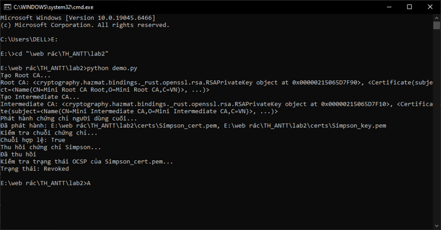
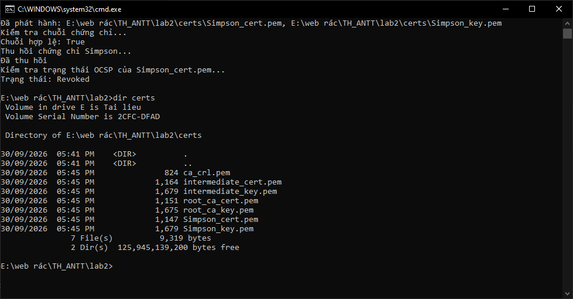
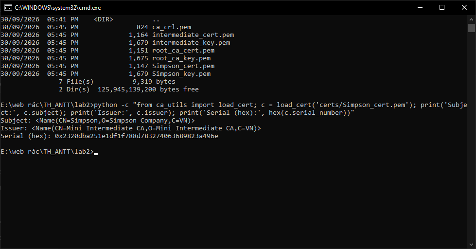
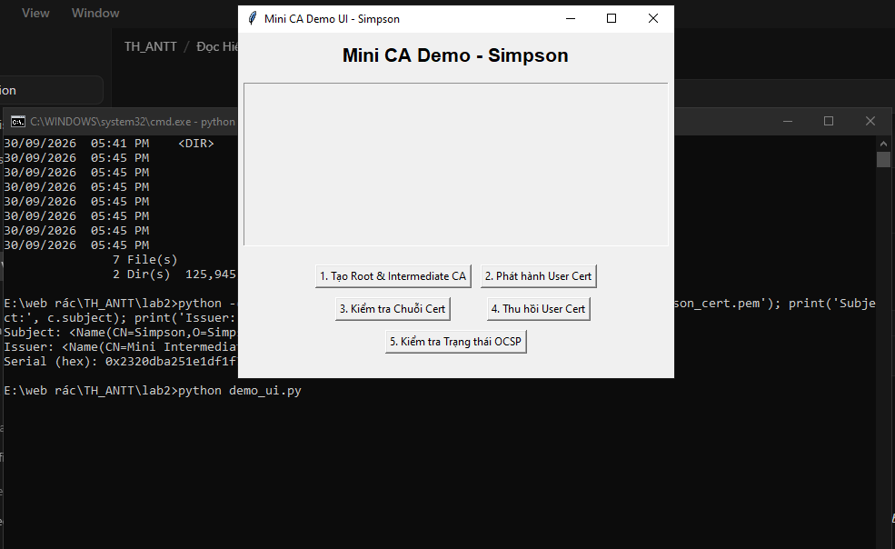
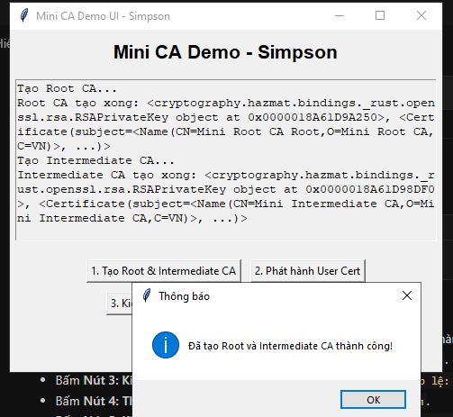
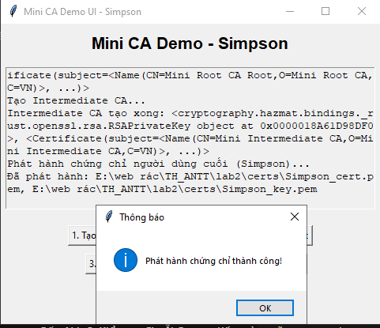
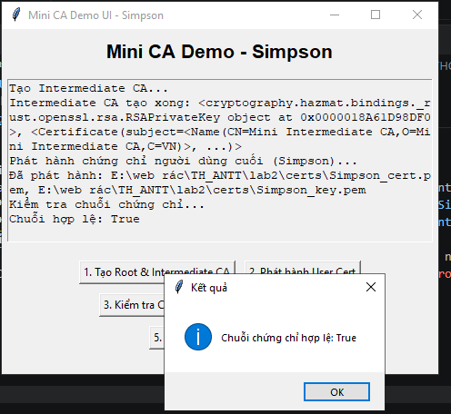
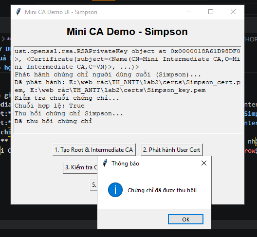
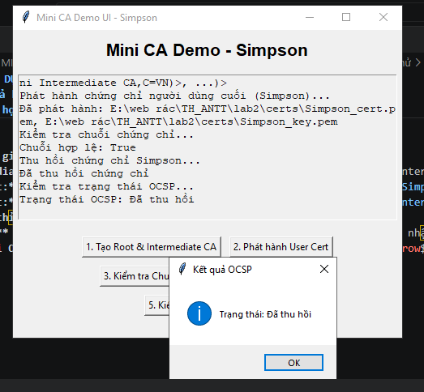
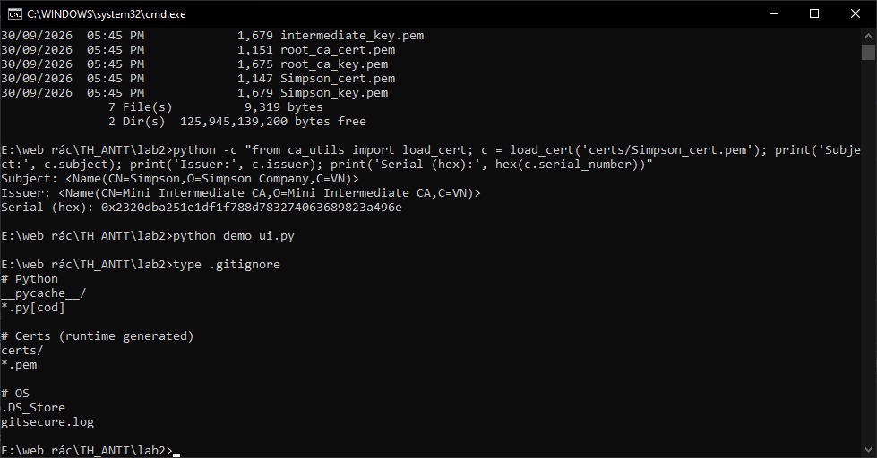

# 📑 BÁO CÁO THỰC HÀNH LAB 2: XÂY DỰNG HỆ THỐNG MINI CERTIFICATE AUTHORITY (PKI)

---

## 👤 Thông tin sinh viên
- **Họ và tên:** Phạm Nguyễn Minh Sơn
- **Mã số sinh viên (MSSV):** 2387700057
- **Lớp:** 23DATA1
- **Môn học:** Thực hành Lập trình An ninh thông tin
- **Bài thực hành:** Bài 2.4 - Lab 2: Thực hành Certificate Authority (Mini CA)

---

## 🎯 Mục tiêu bài thực hành
1. Hiểu và triển khai kiến trúc hạ tầng khóa công khai (**PKI - Public Key Infrastructure**) phân cấp 2 tầng.
2. Tạo chứng chỉ **Root CA** tự ký (Self-signed Certificate) với thời hạn 10 năm (`BasicConstraints: ca=True, path_length=1`).
3. Tạo chứng chỉ **Intermediate CA** được ký bởi Root CA với thời hạn 5 năm (`BasicConstraints: ca=True, path_length=0`).
4. Phát hành chứng chỉ cho người dùng cuối (**End-Entity / User Certificate - Simpson**) được ký bởi Intermediate CA với thời hạn 1 năm (`BasicConstraints: ca=False`).
5. Kiểm tra và xác thực chuỗi chứng chỉ (**Certificate Chain Verification**): `Simpson -> Intermediate CA -> Root CA`.
6. Triển khai danh sách thu hồi chứng chỉ (**CRL - Certificate Revocation List**) và cơ chế kiểm tra trạng thái thu hồi (OCSP/CRL check).
7. Xây dựng giao diện dòng lệnh (**CLI**) và giao diện đồ họa trực quan (**Tkinter GUI**) gồm 5 nút chức năng.
8. Cấu hình tệp `.gitignore` bảo vệ thông tin khóa riêng và tệp chứng chỉ tuân thủ quy chuẩn an toàn **GitSecure**.

---

## 🧪 Các bước thực hiện & Kết quả kiểm thử

### Bước 1: Chạy Demo toàn bộ quy trình PKI qua CLI
- **Mục đích:** Thực hiện tự động toàn bộ vòng đời PKI: Sinh Root CA $\rightarrow$ Sinh Intermediate CA $\rightarrow$ Phát hành User Cert (`Simpson`) $\rightarrow$ Xác thực chuỗi $\rightarrow$ Thu hồi chứng chỉ $\rightarrow$ Kiểm tra trạng thái CRL/OCSP.
- **Lệnh thực hiện trên CMD / PowerShell:**
  ```cmd
  E:
  cd "\web rác\TH_ANTT\lab2"
  python demo.py
  ```
- **Kết quả hiển thị trên màn hình CMD:**
  ```text
  Tạo Root CA...
  Root CA: <cryptography.hazmat.bindings._rust.openssl.rsa.RSAPrivateKey object at 0x000001DE83BD7F30>, <Certificate(subject=<Name(CN=Mini Root CA Root,O=Mini Root CA,C=VN)>, ...)>
  Tạo Intermediate CA...
  Intermediate CA: <cryptography.hazmat.bindings._rust.openssl.rsa.RSAPrivateKey object at 0x000001DE83BD7FB0>, <Certificate(subject=<Name(CN=Mini Intermediate CA,O=Mini Intermediate CA,C=VN)>, ...)>
  Phát hành chứng chỉ người dùng cuối...
  Đã phát hành: E:\web rác\TH_ANTT\lab2\certs\Simpson_cert.pem, E:\web rác\TH_ANTT\lab2\certs\Simpson_key.pem
  Kiểm tra chuỗi chứng chỉ...
  Chuỗi hợp lệ: True
  Thu hồi chứng chỉ Simpson...
  Đã thu hồi
  Kiểm tra trạng thái OCSP của Simpson_cert.pem...
  Trạng thái: Revoked
  ```
- **📸 Ảnh chụp màn hình CMD:**
  
  ![Bước 1: Chạy demo CLI toàn bộ quy trình PKI]

---

### Bước 2: Kiểm tra các tệp chứng chỉ & khóa được sinh ra
- **Mục đích:** Xác minh các tệp khóa bí mật (`.key.pem`), chứng chỉ số (`.cert.pem`) và danh sách thu hồi (`ca_crl.pem`) được lưu trữ đúng cấu trúc trong thư mục `certs/`.
- **Lệnh thực hiện trên CMD / PowerShell:**
  ```cmd
  dir certs
  ```
- **Danh sách tệp nhận được:**
  1. `root_ca_key.pem`: Khóa riêng bí mật của Root CA (RSA 2048-bit).
  2. `root_ca_cert.pem`: Chứng chỉ số tự ký của Root CA (thời hạn 10 năm, `BasicConstraints(ca=True, path_length=1)`).
  3. `intermediate_key.pem`: Khóa riêng của CA trung gian.
  4. `intermediate_cert.pem`: Chứng chỉ số của CA trung gian được Root CA ký (thời hạn 5 năm, `BasicConstraints(ca=True, path_length=0)`).
  5. `Simpson_key.pem`: Khóa riêng của người dùng cuối (Simpson).
  6. `Simpson_cert.pem`: Chứng chỉ số của người dùng cuối được Intermediate CA ký (thời hạn 1 năm, `BasicConstraints(ca=False)`).
  7. `ca_crl.pem`: Danh sách chứng chỉ bị thu hồi (Certificate Revocation List).
- **📸 Ảnh chụp màn hình CMD:**
 


---

### Bước 3: Kiểm tra chi tiết chứng chỉ số X.509
- **Mục đích:** Xem thông tin chi tiết (Subject, Issuer, Serial Number) của chứng chỉ người dùng cuối `Simpson_cert.pem` để chứng minh chứng chỉ đã được cấp phát đúng bởi Intermediate CA.
- **Lệnh thực hiện trên CMD / PowerShell:**
  ```cmd
  python -c "from ca_utils import load_cert; c = load_cert('certs/Simpson_cert.pem'); print('Subject:', c.subject); print('Issuer:', c.issuer); print('Serial (hex):', hex(c.serial_number))"
  ```
- **Kết quả thực tế:**
  ```text
  Subject: <Name(CN=Simpson,O=Simpson Company,C=VN)>
  Issuer: <Name(CN=Mini Intermediate CA,O=Mini Intermediate CA,C=VN)>
  Serial (hex): 0x30a15d1ce47ac46df87670f7dfbcdc26ff619c58
  ```
- **📸 Ảnh chụp màn hình CMD:**
 
---

### Bước 4: Kiểm thử Giao diện Đồ họa Mini CA (Tkinter GUI)
- **Mục đích:** Thao tác trực quan trên giao diện đồ họa với 5 nút chức năng mô phỏng toàn bộ vòng đời PKI.
- **Lệnh khởi động GUI:**
  ```cmd
  python demo_ui.py
  ```
- **Các bước bấm nút tuần tự trên giao diện:**
  1. **Nút 1 - Tạo Root & Intermediate CA:** Khởi tạo cặp khóa RSA và chứng chỉ cho Root CA cùng Intermediate CA.
  2. **Nút 2 - Phát hành User Cert:** Nhập thông tin người dùng `Simpson` và phát hành chứng chỉ `Simpson_cert.pem`.
  3. **Nút 3 - Kiểm tra Chuỗi Cert:** Xác thực chữ ký số dọc theo chuỗi tin cậy PKI: `Simpson -> Intermediate CA -> Root CA` $\rightarrow$ Hiển thị kết quả **Chuỗi chứng chỉ hợp lệ: True**.
  4. **Nút 4 - Thu hồi User Cert:** Thu hồi chứng chỉ người dùng với lý do `key_compromise` và ghi nhận vào tệp `ca_crl.pem`.
  5. **Nút 5 - Kiểm tra Trạng thái OCSP:** Kiểm tra trạng thái chứng chỉ sau khi thu hồi $\rightarrow$ Hiển thị **Trạng thái OCSP: Đã thu hồi**.
- **📸 Ảnh chụp màn hình GUI:**







### Bước 5: Cấu hình an toàn Git (.gitignore theo chuẩn GitSecure)
- **Mục đích:** Đảm bảo toàn bộ khóa riêng tư và chứng chỉ runtime không bị đưa lên Git theo đúng yêu cầu bảo mật ở trang 63-64 giáo trình.
- **Lệnh kiểm tra trên CMD / PowerShell:**
  ```cmd
  type .gitignore
  ```
- **Nội dung tệp `.gitignore`:**
  ```text
  # Python
  __pycache__/
  *.py[cod]

  # Certs (runtime generated)
  certs/
  *.pem

  # OS
  .DS_Store
  gitsecure.log
  ```


- **Đánh giá:** Các tệp `.pem` và thư mục `certs/` đã được loại trừ hoàn toàn khỏi Git tracking, đảm bảo qua được khâu kiểm tra an toàn mã nguồn GitSecure khi commit.

---

## 📝 Đánh giá và Kết luận
- Hệ thống **Mini CA** đã mô phỏng chính xác mô hình PKI phân cấp 2 tầng thực tế (Hierarchical CA).
- Chuỗi tin cậy được thiết lập chặt chẽ: Root CA ủy quyền cho Intermediate CA, và Intermediate CA phát hành chứng chỉ cho End-Entity (`Simpson`).
- Cơ chế thu hồi chứng chỉ qua CRL hoạt động hiệu quả, ngăn chặn việc sử dụng các chứng chỉ đã bị lộ khóa bí mật hoặc hết giá trị sử dụng.
- Cả 2 giao diện dòng lệnh (CLI) và đồ họa (Tkinter GUI) đều hoạt động trơn tru, xử lý encoding UTF-8 tiếng Việt hoàn hảo trên môi trường Windows.
