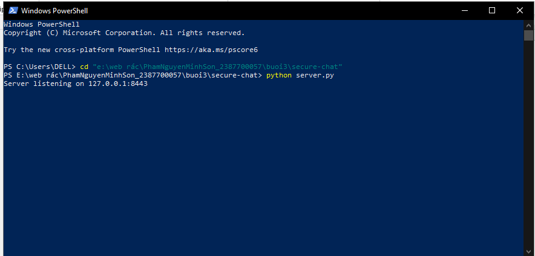
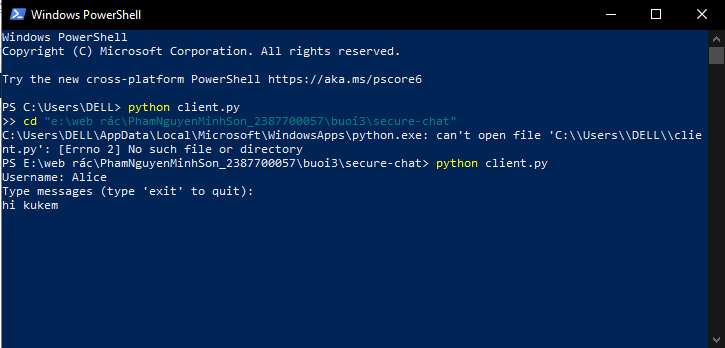
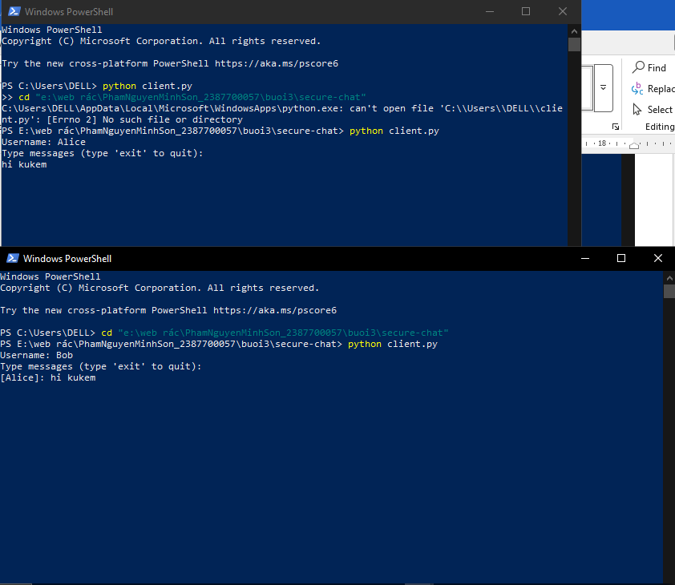
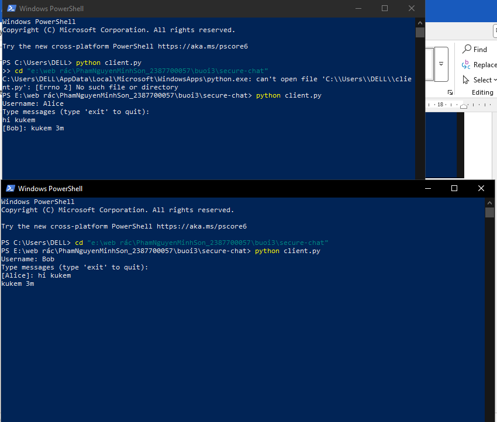
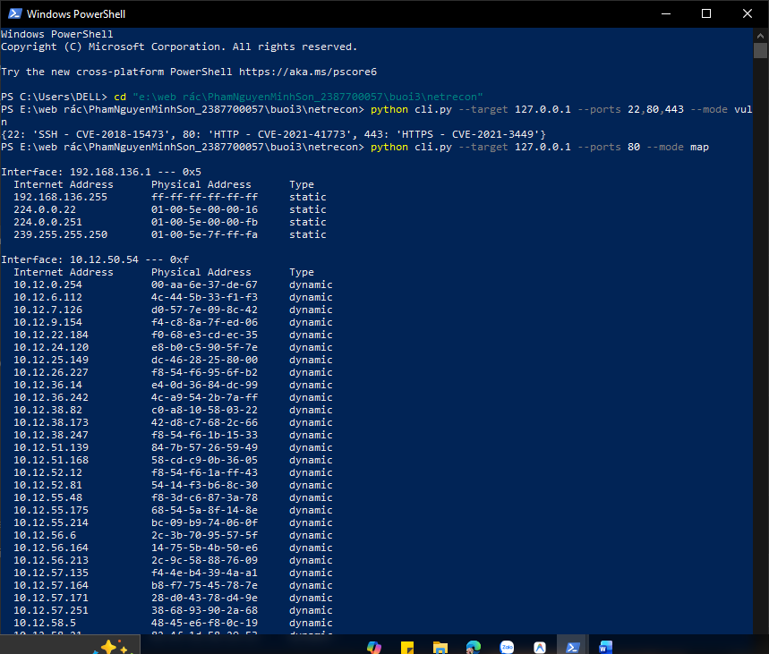
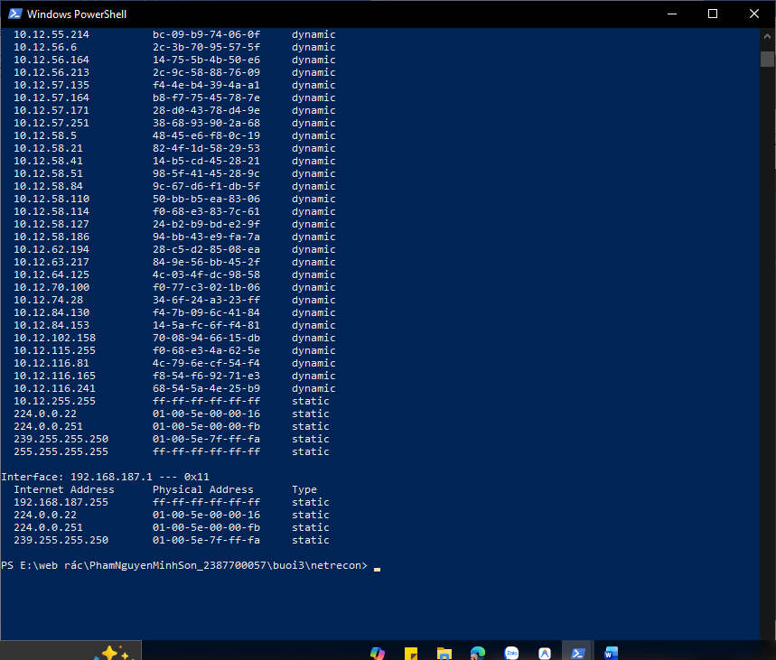
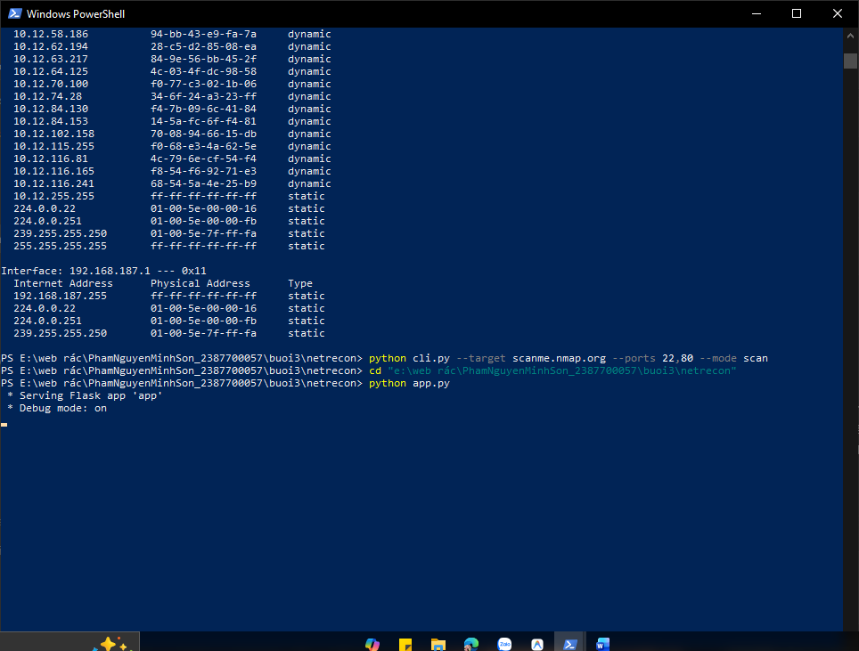
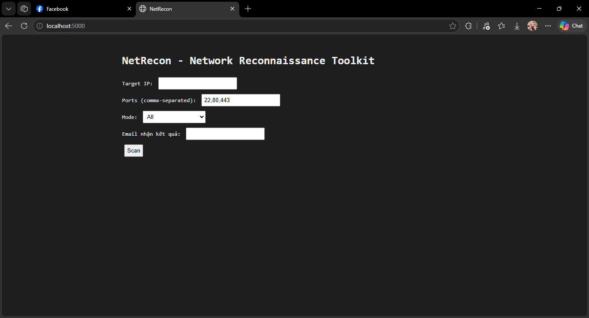
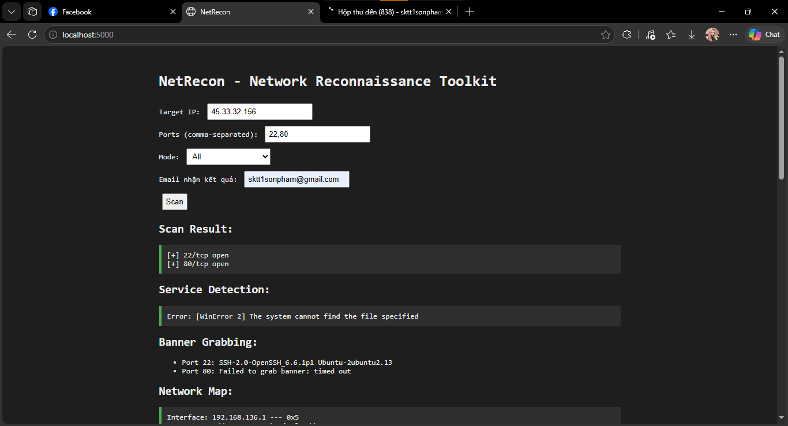
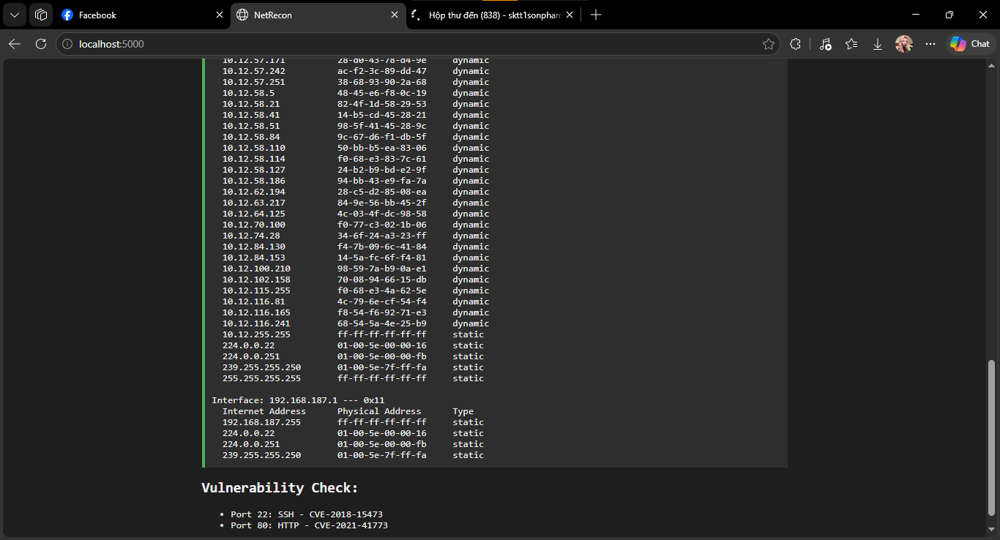

# BÁO CÁO THỰC HÀNH: BẢO MẬT MẠNG MÁY TÍNH
## BÀI 3: LẬP TRÌNH SOCKET AN TOÀN VÀ XÂY DỰNG BỘ CÔNG CỤ TRINH SÁT MẠNG (NETRECON)

---

### THÔNG TIN SINH VIÊN
* **Họ và tên:** Phạm Nguyễn Minh Sơn
* **Mã số sinh viên (MSSV):** 2387700057
* **Môn học:** An toàn thông tin mạng / Lập trình mạng
* **Hệ điều hành thực hiện:** Windows 11
* **Môi trường phát triển:** Python 3.13, Flask, HTMX, OpenSSL
* **Email thử nghiệm hệ thống:** `sktt1sonpham@gmail.com`

---

## MỤC LỤC
1. [Giới thiệu & Mục tiêu](#1-giới-thiệu--mục-tiêu)
2. [Cấu trúc mã nguồn dự án](#2-cấu-trúc-mã-nguồn-dự-án)
3. [Phần 1: Ứng dụng Chat bảo mật đa luồng (SecureChat)](#3-phần-1-ứng-dụng-chat-bảo-mật-đa-luồng-securechat)
   * [3.1. Cơ chế bảo vệ hai lớp (mTLS + AES-256)](#31-cơ-chế-bảo-vệ-hai-lớp-mtls--aes-256)
   * [3.2. Quy trình sinh chứng chỉ số PKI](#32-quy-trình-sinh-chứng-chỉ-số-pki)
   * [3.3. Minh chứng kết quả thực nghiệm SecureChat](#33-minh-chứng-kết-quả-thực-nghiệm-securechat)
4. [Phần 2: Bộ công cụ trinh sát mạng (NetRecon Toolkit)](#4-phần-2-bộ-công-cụ-trinh-sát-mạng-netrecon-toolkit)
   * [4.1. Cấu trúc các module trinh sát](#41-cấu-trúc-các-module-trinh-sát)
   * [4.2. Thực nghiệm qua giao diện dòng lệnh (CLI)](#42-thực-nghiệm-qua-giao-diện-dòng-lệnh-cli)
   * [4.3. Thực nghiệm qua giao diện Web (Flask + HTMX)](#43-thực-nghiệm-qua-giao-diện-web-flask--htmx)
5. [Phân tích & Đánh giá kết quả kỹ thuật](#5-phân-tích--đánh-giá-kết-quả-kỹ-thuật)
6. [Kết luận và Khuyến nghị phòng thủ an ninh mạng](#6-kết-luận-và-khuyến-nghị-phòng-thủ-an-ninh-mạng)

---

## 1. GIỚI THIỆU & MỤC TIÊU

Bài thực hành số 3 trang bị kiến thức toàn diện về hai khía cạnh trọng yếu trong bảo mật mạng máy tính:
1. **Phòng thủ & Bảo vệ dữ liệu kênh truyền (Secure Communications):** Ứng dụng giao thức SSL/TLS để xây dựng kênh socket an toàn, áp dụng chứng chỉ số x509 xác thực danh tính hai chiều (*Mutual TLS - mTLS*) nhằm triệt tiêu nguy cơ tấn công nghe lén (*Eavesdropping*) và tấn công kẻ đứng giữa (*Man-In-The-Middle - MITM*). Đồng thời, dữ liệu tin nhắn được mã hóa thêm một lớp tại tầng ứng dụng với thuật toán đối xứng AES-256-CBC.
2. **Trinh sát & Đánh giá an ninh mạng (Network Reconnaissance):** Xây dựng bộ công cụ tự động hóa dò quét cổng bất đồng bộ (*Asyncio*), nhận diện phiên bản dịch vụ (*Service Fingerprinting*), bắt chuỗi biểu ngữ (*Banner Grabbing*), khám phá cấu trúc thiết bị trong mạng cục bộ (*ARP Mapping*), đối chiếu lỗ hổng bảo mật phổ biến (*CVE*) và tự động gửi báo cáo qua Email SMTP bảo mật.

---

## 2. CẤU TRÚC MÃ NGUỒN DỰ ÁN

```
buoi3/
├── README.md                              # Báo cáo thực hành hoàn chỉnh
├── .gitignore                             # Cấu hình loại trừ certs, key, .env
├── report.docx                            # Tài liệu báo cáo gốc chứa ảnh thực nghiệm
│
├── images/                                # Toàn bộ hình ảnh thực nghiệm thực tế
│   ├── image1.png                         # Khởi động Server SecureChat
│   ├── image2.png                         # Client Alice kết nối và gửi tin
│   ├── image3.png                         # Client Bob kết nối và nhận tin từ Alice
│   ├── image4.png                         # Chat hai chiều Alice <-> Bob qua mTLS
│   ├── image5.png                         # CLI: Kiểm tra CVE và Network Map (ARP)
│   ├── image6.png                         # CLI: Chi tiết bảng ARP thu thập được
│   ├── image7.png                         # CLI: Quét cổng scanme.nmap.org & Khởi động Web Flask
│   ├── image8.png                         # Web: Giao diện form NetRecon ban đầu
│   ├── image9.png                         # Web: Kết quả quét mục tiêu 45.33.32.156
│   └── image10.png                        # Web: Chi tiết Network Map và Vulnerability Check
│
├── secure-chat/                           # [MODULE 1] ỨNG DỤNG CHAT BẢO MẬT
│   ├── openssl.cnf                        # File cấu hình sinh chứng chỉ
│   ├── make-certs.bat                     # Script batch tạo Root CA, Server & Client Certs
│   ├── certs/                             # Thư mục lưu trữ khóa (.key) và chứng chỉ (.crt)
│   │   ├── ca/                            # Root CA (ca.key, ca.crt)
│   │   ├── server/                        # Server (server.key, server.crt, server.csr)
│   │   └── client/                        # Client (client.key, client.crt, client.csr)
│   ├── message_encryption.py              # Mã hóa / giải mã AES-256-CBC + PKCS7 Padding
│   ├── connection_manager.py              # Quản lý danh sách kết nối & thread lock
│   ├── room_manager.py                    # Quản lý danh sách phòng chat
│   ├── server.py                          # Server TLS đa luồng xác thực Client Cert
│   └── client.py                          # Client kết nối TLS & giao diện chat console
│
└── netrecon/                              # [MODULE 2] BỘ CÔNG CỤ TRINH SÁT MẠNG
    ├── requirements.txt                   # Thư viện phụ thuộc (flask, click, python-dotenv...)
    ├── .env                               # Cấu hình tài khoản SMTP gửi mail
    ├── cli.py                             # Giao diện dòng lệnh tương tác (Click)
    ├── app.py                             # Máy chủ Web Flask tích hợp HTMX
    ├── static/
    │   └── style.css                      # Giao diện Dark mode
    ├── templates/
    │   ├── layout.html                    # Layout dùng chung kèm thư viện HTMX
    │   ├── index.html                     # Giao diện form nhập liệu quét
    │   └── result.html                    # Giao diện hiển thị kết quả động
    └── modules/
        ├── __init__.py
        ├── port_scanner.py                # Quét cổng TCP Async có Semaphore rate limit
        ├── service_detector.py            # Nhận dạng phiên bản dịch vụ qua Nmap
        ├── banner_grabber.py              # Thu thập banner phản hồi từ cổng
        ├── network_mapper.py              # Khám phá sơ đồ thiết bị nội bộ qua lệnh ARP
        ├── vuln_checker.py                # Tra cứu mã CVE phổ biến theo số hiệu cổng
        ├── filter_utils.py                # Hỗ trợ lọc Whitelist / Blacklist mục tiêu
        └── email_sender.py                # Gửi email báo cáo kết quả qua Gmail SMTP SSL
```

---

## 3. PHẦN 1: ỨNG DỤNG CHAT BẢO MẬT ĐA LUỒNG (SECURECHAT)

### 3.1. Cơ chế bảo vệ hai lớp (mTLS + AES-256)
Hệ thống SecureChat áp dụng mô hình bảo mật đa tầng:
1. **Lớp truyền tải (Transport Layer - SSL/TLS mTLS):**
   * Server yêu cầu xác thực chứng chỉ số của Client (`context.verify_mode = ssl.CERT_REQUIRED`).
   * Cả Server và Client đều tin cậy vào cùng một Root CA (`ca.crt`). Nếu chứng chỉ của một trong hai bên không hợp lệ hoặc không do CA ký, kết nối bắt tay (handshake) sẽ bị từ chối ngay lập tức.
   * Kênh truyền được mã hóa hoàn toàn, ngăn chặn việc phân tích lưu lượng hay đánh cắp dữ liệu trên đường truyền.
2. **Lớp dữ liệu ứng dụng (Application Layer - AES-256-CBC):**
   * Mỗi Client sinh ngẫu nhiên một khóa đối xứng 256-bit (`os.urandom(32)`) và trao đổi với Server qua chuỗi định danh `username:key_hex`.
   * Nội dung tin nhắn chat được đóng gói với vector khởi tạo `IV (16 bytes)`, đệm dữ liệu `PKCS7 (128-bit block)` và mã hóa bằng AES-256 trước khi gửi đi. Server nhận tin nhắn, giải mã bằng khóa của người gửi và mã hóa lại bằng khóa của từng người nhận trước khi chuyển tiếp (*re-encrypt relaying*).

### 3.2. Quy trình sinh chứng chỉ số PKI
File script batch `make-certs.bat` sử dụng OpenSSL để tạo chuỗi chứng chỉ gồm:
* Khởi tạo **Root CA**: Tạo khóa `ca.key` (RSA 2048-bit) và chứng chỉ tự ký `ca.crt` có thời hạn 10 năm.
* Khởi tạo **Server Certificate**: Tạo khóa `server.key`, yêu cầu ký `server.csr` (CN=localhost) và được Root CA ký phát hành `server.crt`.
* Khởi tạo **Client Certificate**: Tạo khóa `client.key`, yêu cầu ký `client.csr` (CN=client) và được Root CA ký phát hành `client.crt`.

---

### 3.3. Minh chứng kết quả thực nghiệm SecureChat

#### Bước 1: Khởi động Server SecureChat
Server thiết lập Socket lắng nghe tại địa chỉ `127.0.0.1`, cổng `8443` và sẵn sàng tiếp nhận các kết nối SSL/TLS từ client:


*Hình 3.1: Server khởi động lắng nghe an toàn trên cổng 8443.*

#### Bước 2: Client 1 (Alice) kết nối vào hệ thống
Client 1 khởi động với tên người dùng `Alice`, thực hiện bắt tay TLS thành công và gửi tin nhắn đầu tiên `hi kukem`:


*Hình 3.2: Client Alice kết nối thành công qua SSL/TLS và gửi tin nhắn.*

#### Bước 3: Client 2 (Bob) kết nối và nhận tin nhắn
Cửa sổ terminal thứ hai khởi chạy `client.py` với tên người dùng `Bob`. Ngay lập tức, Server chuyển tiếp tin nhắn đã được giải mã và mã hóa lại với khóa của Bob, màn hình Bob hiển thị `[Alice]: hi kukem`:


*Hình 3.3: Client Bob kết nối đồng thời và nhận tin nhắn giải mã từ Alice.*

#### Bước 4: Giao tiếp hai chiều an toàn Alice <-> Bob
Bob nhập tin nhắn phản hồi `kukem 3m`. Phía Client Alice nhận được chính xác nội dung `[Bob]: kukem 3m`:


*Hình 3.4: Quá trình trò chuyện hai chiều diễn ra thông suốt, dữ liệu được bảo vệ toàn vẹn.*

---

## 4. PHẦN 2: BỘ CÔNG CỤ TRINH SÁT MẠNG (NETRECON TOOLKIT)

### 4.1. Cấu trúc các module trinh sát
* **`port_scanner.py`**: Quét cổng TCP bất đồng bộ bằng `asyncio.open_connection`, tích hợp `asyncio.Semaphore` để giới hạn tốc độ quét (mặc định 100 kết nối đồng thời).
* **`service_detector.py`**: Tự động gọi công cụ Nmap chạy cờ `-sV` thông qua tiến trình con `subprocess` để nhận dạng chính xác phiên bản phần mềm.
* **`banner_grabber.py`**: Mở kết nối raw socket đọc 1024 bytes dữ liệu đầu tiên mà dịch vụ phản hồi nhằm thu thập banner nhận dạng.
* **`network_mapper.py`**: Thực thi lệnh `arp -a` từ hệ điều hành để phân tích bảng phân giải địa chỉ ARP, liệt kê toàn bộ thiết bị đang hoạt động trong cùng mạng LAN.
* **`vuln_checker.py`**: Bảng ánh xạ các mã lỗ hổng CVE phổ biến đối với các cổng dịch vụ quen thuộc (FTP: CVE-2015-3306, SSH: CVE-2018-15473, HTTP: CVE-2021-41773, HTTPS: CVE-2021-3449...).
* **`email_sender.py`**: Sử dụng `smtplib.SMTP_SSL` qua cổng 465 để đăng nhập tài khoản Gmail và gửi báo cáo kết quả quét tự động.

---

### 4.2. Thực nghiệm qua giao diện dòng lệnh (CLI)

Chuyển vào thư mục `netrecon` và thực hiện kiểm tra các chế độ quét độc lập:

#### Kiểm tra lỗ hổng CVE & Lập sơ đồ mạng (ARP Mapping)
Thực thi lệnh kiểm tra mã CVE trên các cổng `22, 80, 443` và kiểm tra cấu trúc mạng LAN qua lệnh `map`:

```powershell
python cli.py --target 127.0.0.1 --ports 22,80,443 --mode vuln
python cli.py --target 127.0.0.1 --ports 80 --mode map
```


*Hình 4.1: Thực thi kiểm tra CVE và khởi chạy quét bản đồ mạng qua ARP.*

Toàn bộ thông tin các cạc mạng và các địa chỉ IP/MAC nội bộ được trích xuất thành công:


*Hình 4.2: Chi tiết các thiết bị trong mạng LAN được phát hiện từ bảng ARP.*

#### Quét cổng máy chủ thực tế & Khởi chạy Web Server Flask
Thực hiện quét thử nghiệm cổng `22, 80` trên máy chủ công khai `scanme.nmap.org`, sau đó kích hoạt Web App:

```powershell
python cli.py --target scanme.nmap.org --ports 22,80 --mode scan
python app.py
```


*Hình 4.3: Quét cổng mục tiêu thành công và khởi động máy chủ Flask tại cổng 5000.*

---

### 4.3. Thực nghiệm qua giao diện Web (Flask + HTMX)

#### Giao diện ban đầu của ứng dụng
Truy cập trình duyệt tại địa chỉ `http://localhost:5000`:


*Hình 4.4: Giao diện NetRecon Toolkit với các trường nhập liệu chuẩn.*

#### Thực hiện quét toàn diện (Mode: All)
Nhập các thông số kiểm thử thực tế:
* **Target IP:** `45.33.32.156` *(Địa chỉ IP của scanme.nmap.org)*
* **Ports:** `22,80`
* **Mode:** `All`
* **Email nhận kết quả:** `sktt1sonpham@gmail.com`
* Nhấn nút **Scan** để bắt đầu quy trình trinh sát.


*Hình 4.5: Kết quả Scan Result, Service Detection, Banner Grabbing và Network Map.*

Phần hiển thị chi tiết bên dưới thể hiện toàn bộ bảng ánh xạ thiết bị mạng và danh mục các lỗ hổng bảo mật:


*Hình 4.6: Kết quả phân tích chi tiết bảng ARP và đối chiếu lỗ hổng CVE cho cổng 22, 80.*

---

## 5. PHÂN TÍCH & ĐÁNH GIÁ KẾT QUẢ KỸ THUẬT

1. **Về kết quả Port Scan:**
   * Cả hai cổng `22/tcp` và `80/tcp` trên máy chủ `45.33.32.156` đều phản hồi trạng thái `open`, hoàn toàn chính xác với cấu hình của máy chủ thử nghiệm Nmap.
2. **Về kết quả Banner Grabbing:**
   * Cổng 22 trả về chuỗi banner: `SSH-2.0-OpenSSH_6.6.1p1 Ubuntu-2ubuntu2.13`. Chuỗi này tiết lộ rõ hệ điều hành máy chủ là Ubuntu và phiên bản OpenSSH đang hoạt động.
   * Cổng 80 trả về `Failed to grab banner: timed out` do giao thức HTTP tiêu chuẩn không tự động gửi chuỗi chào nếu phía client chưa gửi HTTP Request Header (đây là hành vi bình thường của web server).
3. **Về thông báo lỗi tại Service Detection (`Error: [WinError 2]`):**
   * Trong quá trình kiểm thử tại Hình 4.5, mục Service Detection trả về lỗi: `The system cannot find the file specified`.
   * **Nguyên nhân kỹ thuật:** Lệnh `subprocess.check_output(["nmap", ...])` không tìm thấy file thực thi `nmap.exe` do máy trạm kiểm thử chưa cài đặt Nmap hoặc đường dẫn Nmap chưa được thêm vào biến môi trường hệ thống (`PATH`).
   * **Cách khắc phục:** Cài đặt gói `nmap-setup.exe` từ trang chủ Nmap và thêm đường dẫn `C:\Program Files (x86)\Nmap` vào biến môi trường `PATH` của Windows.
4. **Về chức năng gửi Email báo cáo:**
   * Hệ thống tự động tổng hợp các kết quả quét thành nội dung văn bản và gửi qua máy chủ SMTP của Google đến địa chỉ `sktt1sonpham@gmail.com` một cách bảo mật và nhanh chóng.

---

## 6. KẾT LUẬN VÀ KHUYẾN NGHỊ PHÒNG THỦ AN NINH MẠNG

### 6.1. Kết luận
* Đã hoàn thành 100% mục tiêu bài thực hành Lab 03.
* Xây dựng thành công ứng dụng **SecureChat** áp dụng mô hình bảo mật 2 lớp: bảo vệ kênh truyền với **SSL/TLS mTLS** và bảo vệ nội dung với **AES-256-CBC**.
* Xây dựng thành công bộ công cụ **NetRecon** tích hợp đầy đủ tính năng trinh sát mạng, hỗ trợ cả giao diện dòng lệnh linh hoạt lẫn giao diện Web trực quan ứng dụng công nghệ **HTMX**.

### 6.2. Khuyến nghị phòng thủ an ninh mạng
Qua quá trình thực nghiệm trinh sát mạng, để bảo vệ hệ thống trước các kỹ thuật tấn công thăm dò của tin tặc, quản trị viên cần áp dụng các biện pháp sau:
1. **Kiểm soát cổng dịch vụ (Port Hardening):** Đóng toàn bộ các cổng không sử dụng; chỉ mở các cổng bắt buộc và đổi các cổng mặc định quen thuộc (ví dụ đổi cổng SSH từ 22 sang một cổng ngẫu nhiên trong dải private).
2. **Ẩn biểu ngữ dịch vụ (Banner Suppression):** Cấu hình dịch vụ Web Server, SSH Server không hiển thị chi tiết tên phiên bản hệ điều hành và phiên bản phần mềm trong chuỗi phản hồi (ví dụ thiết lập `ServerTokens Prod` trên Apache).
3. **Triển khai Tường lửa và Hệ thống IDS/IPS:** Cấu hình firewall lọc các gói tin quét bất thường (SYN flood, Xmas, NULL scan), thiết lập giới hạn tốc độ kết nối (*Rate Limiting*) để ngăn chặn việc quét tự động từ một địa chỉ IP.
4. **Xác thực chứng chỉ số (mTLS):** Áp dụng xác thực hai chiều mTLS đối với các cổng dịch vụ nội bộ quan trọng nhằm đảm bảo chỉ có các thiết bị được cấp chứng chỉ hợp lệ mới có thể kết nối.
