# BÁO CÁO THỰC HÀNH BÀI 5: PHÂN TÍCH VÀ KIỂM THỬ BẢO MẬT (SAST & DAST)

* **Họ và tên:** Phạm Nguyễn Minh Sơn  
* **Mã số sinh viên (MSSV):** 2387700057  
* **Môn học:** Lập trình An toàn Thông tin  
* **Bài thực hành:** Bài 5 - Static & Dynamic Analysis Security Testing  
* **GitHub Repository:** [https://github.com/Simpson-31ev3n/PhamNguyenMinhSon_2387700057.git](https://github.com/Simpson-31ev3n/PhamNguyenMinhSon_2387700057.git)  

---

## MỤC TIÊU BÀI THỰC HÀNH

1. **Static Analysis Security Testing (SAST):**
   * Hiểu và ứng dụng biểu diễn cây cú pháp trừu tượng AST (*Abstract Syntax Tree*) qua thư viện `ast` của Python để phân tích tĩnh mã nguồn mà không cần chạy chương trình.
   * Sử dụng kỹ thuật đối khớp mẫu (*Pattern Matching*) bằng Regular Expressions nhằm phát hiện thông tin nhạy cảm (hardcoded credentials) và thư viện không an toàn (`pickle`).
   * Tích hợp công cụ đánh giá chất lượng code (*Linter - flake8*) để đo lường độ sạch và vi phạm quy chuẩn.
   * Xây dựng hệ thống quy tắc bảo mật (*Security Rule Engine*) và xuất báo cáo chuẩn công nghiệp SARIF (*Static Analysis Results Interchange Format*).

2. **Dynamic Analysis Security Testing (DAST):**
   * Nắm vững kỹ thuật Runtime Security Testing (RST) để giám sát và phân tích hành vi chương trình trong khi thực thi.
   * Giám sát tài nguyên hệ thống (CPU, RAM, Open Files, I/O mạng) bằng thư viện `psutil`.
   * Phát hiện các lỗi bộ nhớ (Memory Leak thông qua `gc.garbage`, kiểm tra tràn số Buffer/Integer Overflow).
   * Phát hiện hành vi nguy hiểm (System calls độc hại như `os.system`, `eval`, `exec`).
   * Xây dựng môi trường hộp cát (*Virtual Sandbox*) cách ly thư mục thực thi.
   * Đóng gói dịch vụ giám sát động dưới dạng Flask RESTful API.

---

# PHẦN 1: THỰC HÀNH XÂY DỰNG CÔNG CỤ SAST-TOOL

### 1.1 Cài đặt môi trường và các gói phụ thuộc
Công cụ SAST yêu cầu các thư viện:
* `flake8`: Kiểm tra quy chuẩn và linting mã nguồn Python.
* `sarif-om`: Xây dựng cấu trúc Object Model cho chuẩn SARIF 2.1.0.
* `jsonpickle`: Serialize cây đối tượng thành file JSON theo chuẩn SARIF.

Chạy lệnh cài đặt:
```powershell
cd "e:\web rác\PhamNguyenMinhSon_2387700057\buoi5\sast-tool"
pip install -r .\requirements.txt
```

> **Hình 1:** Cài đặt thành công các gói phụ thuộc cho `sast-tool`.
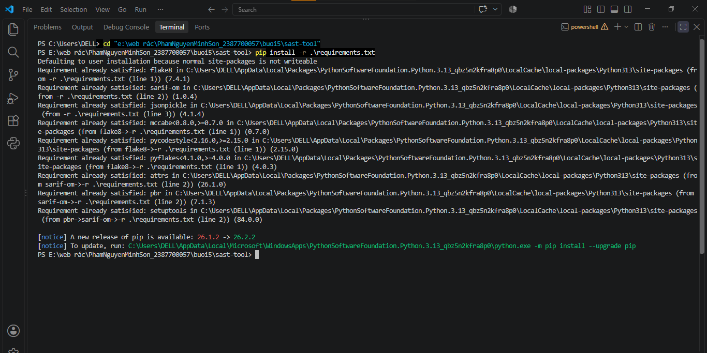

---

### 1.2 Cài đặt các module cốt lõi của SAST-TOOL

#### a. Module `ASTAnalyzer` (`sast_tool/ast_analyzer.py`)
Module duyệt cây cú pháp trừu tượng bằng `ast.walk()`. Khi gặp nút gọi hàm `ast.Call` với tên hàm là `eval`, công cụ sẽ gắn nhãn cảnh báo nguy hiểm kèm vị trí dòng (`lineno`) và cột (`col_offset`).

> **Hình 2:** Mã nguồn module ASTAnalyzer phân tích cấu trúc cú pháp mã nguồn.
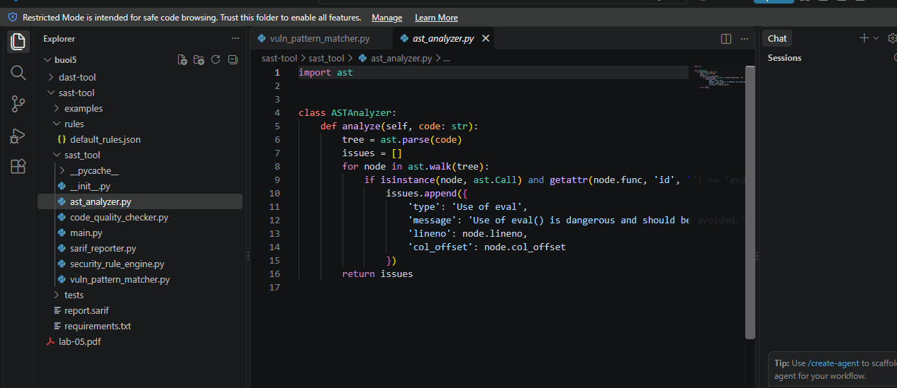

#### b. Module `CodeQualityChecker` (`sast_tool/code_quality_checker.py`)
Sử dụng module `subprocess` gọi `flake8` kiểm tra cú pháp và chất lượng mã nguồn, tự động phân tách kết quả trả về (`line:col:code:msg`) thành danh sách các cảnh báo `Lint Issue`.

> **Hình 3:** Mã nguồn module CodeQualityChecker tích hợp flake8.
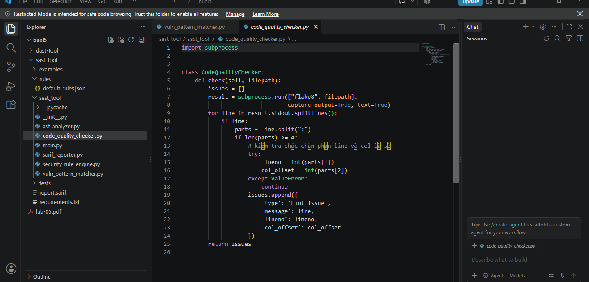

#### c. Module `VulnPatternMatcher` (`sast_tool/vuln_pattern_matcher.py`)
Sử dụng biểu thức chính quy (Regex) quét chuỗi code để phát hiện:
* Hardcoded password: `r'password\s*=\s*".*"'`
* Sử dụng module tuần tự hóa không an toàn: `r'import\s+pickle'`

> **Hình 4:** Mã nguồn module VulnPatternMatcher tìm kiếm mẫu lỗ hổng.
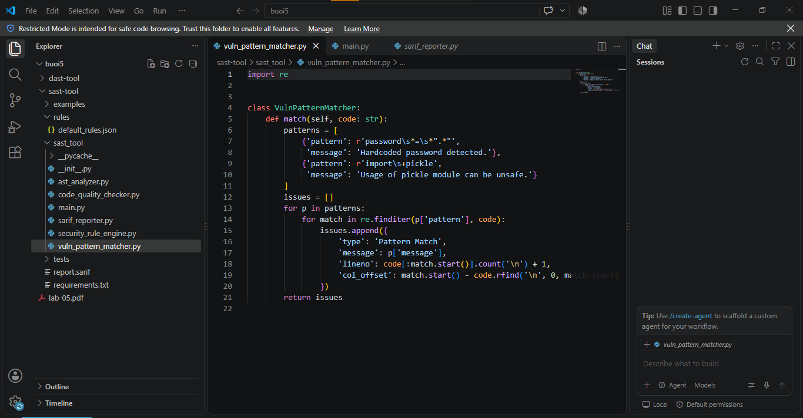

#### d. Module thực thi chính `main.py` (`sast_tool/main.py`)
Liên kết toàn bộ các module: nhận file đầu vào, chạy `ASTAnalyzer`, `VulnPatternMatcher`, `CodeQualityChecker`, áp dụng luật mức độ nghiêm trọng từ `SecurityRuleEngine` và xuất file `report.sarif` thông qua `SarifReporter`.

> **Hình 5:** Mã nguồn module thực thi chính sast_tool/main.py.
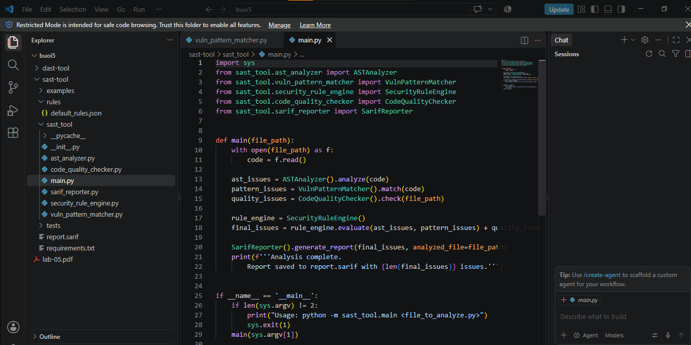

---

### 1.3 Kiểm thử đơn vị (Unit Tests) cho SAST-TOOL
Tất cả 5 test case kiểm tra tính đúng đắn của từng thành phần: `TestASTAnalyzer`, `TestCodeQualityChecker`, `TestSarifReporter`, `TestSecurityRuleEngine`, `TestVulnPatternMatcher`.

Chạy kiểm thử:
```powershell
python -m unittest discover tests
```

> **Hình 6:** Kết quả chạy Unit Test cho SAST-TOOL: 6/6 test cases đều đạt (OK).
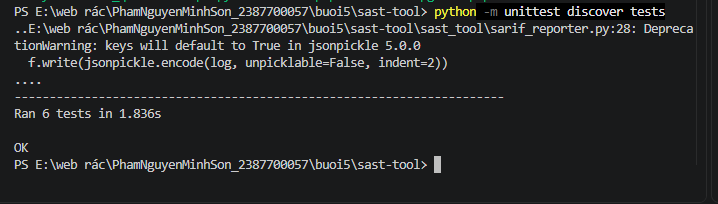

---

### 1.4 Thực thi phân tích trên các tệp mã nguồn mẫu

#### a. Kiểm tra file không an toàn thứ nhất (`examples/vulnerable_01.py`)
File `vulnerable_01.py` chứa hardcoded password, thư viện `pickle` và hàm gọi `eval()`.
```powershell
python -m sast_tool.main .\examples\vulnerable_01.py
```
* **Kết quả:** Phát hiện chính xác **8 issues** (bao gồm cả lỗi logic bảo mật và vi phạm chuẩn định dạng PEP8 từ flake8), được lưu vào file `report.sarif`.

> **Hình 7:** Toàn cảnh giao diện thực thi phân tích file vulnerable_01.py.
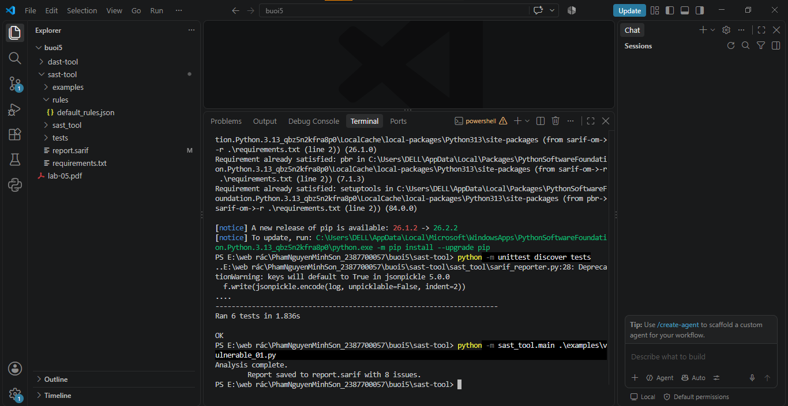

> **Hình 8:** Chi tiết kết quả Terminal báo cáo 8 issues tìm thấy trong vulnerable_01.py.
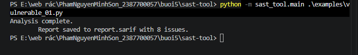

#### b. Kiểm tra file không an toàn thứ hai (`examples/vulnerable_02.py`)
File `vulnerable_02.py` chứa hàm `eval(user_input)` không kiểm soát đầu vào và `exec(code)`.
```powershell
python -m sast_tool.main .\examples\vulnerable_02.py
```
* **Kết quả:** Phát hiện chính xác **4 issues** và ghi đè cập nhật vào `report.sarif`.

> **Hình 9:** Kết quả phân tích vulnerable_02.py phát hiện chính xác 4 issues.
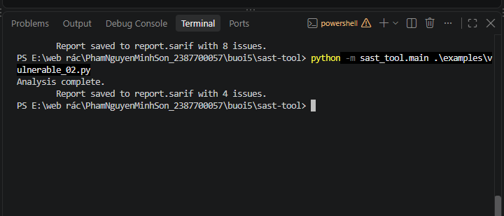

---

### 1.5 Quản lý phiên bản mã nguồn với Git
Thực hiện commit và push toàn bộ mã nguồn lên GitHub repository. Kiểm tra lịch sử commit bằng lệnh:
```powershell
git log -1 --stat
```

> **Hình 10:** Lịch sử commit Git xác nhận mã nguồn đã được lưu trữ an toàn.
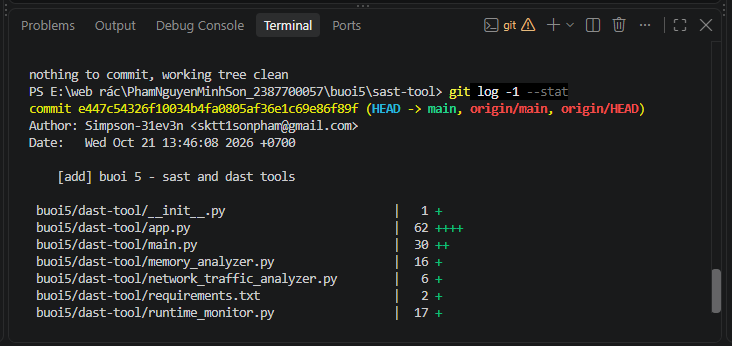

---

# PHẦN 2: THỰC HÀNH XÂY DỰNG CÔNG CỤ DAST-TOOL

### 2.1 Cài đặt môi trường DAST
Công cụ DAST yêu cầu:
* `psutil`: Truy xuất thông tin tiến trình và phần cứng hệ thống (CPU, RAM, Mạng, Files).
* `Flask`: Triển khai dịch vụ phân tích động qua HTTP REST API.

Cài đặt bằng lệnh:
```powershell
cd "e:\web rác\PhamNguyenMinhSon_2387700057\buoi5\dast-tool"
pip install -r .\requirements.txt
```

> **Hình 11:** Cài đặt các thư viện psutil và Flask cho DAST-TOOL.
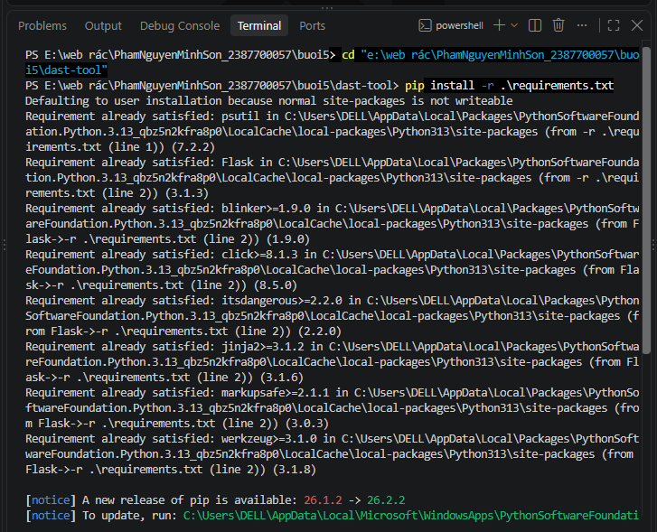

---

### 2.2 Cài đặt các module phân tích động

#### a. Module `RuntimeMonitor` (`dast-tool/runtime_monitor.py`)
Khởi tạo với Process ID (`pid`), cho phép đo phần trăm sử dụng CPU (`cpu_percent`), lượng RAM RSS đang chiếm dụng (`memory_info().rss`), và danh sách file descriptor đang mở (`open_files()`).

> **Hình 12:** Mã nguồn module RuntimeMonitor giám sát tài nguyên runtime.
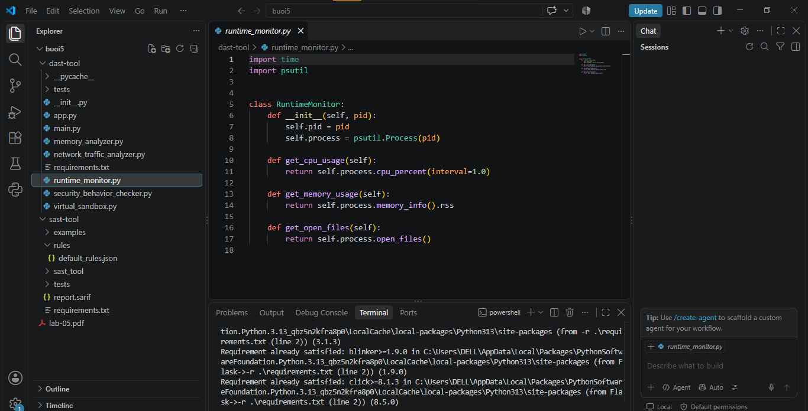

#### b. Module `MemoryAnalyzer` (`dast-tool/memory_analyzer.py`)
Sử dụng Garbage Collector `gc` để thu gom rác và tìm đối tượng rò rỉ bộ nhớ (`gc.garbage`), đồng thời kiểm tra nguy cơ tràn số Integer/Buffer Overflow (`abs(value) > 2**63`).

> **Hình 13:** Mã nguồn module MemoryAnalyzer kiểm tra rò rỉ và tràn số.
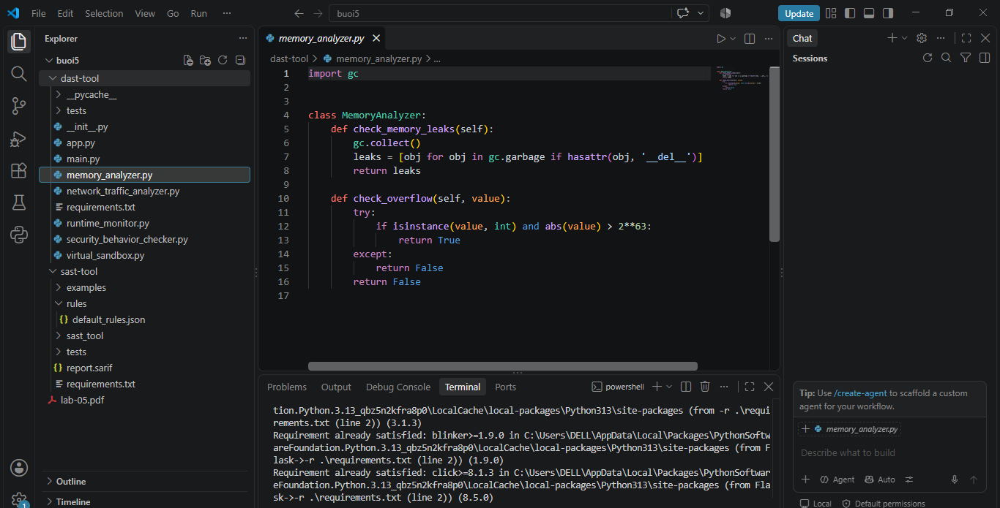

#### c. Module `NetworkTrafficAnalyzer` (`dast-tool/network_traffic_analyzer.py`)
Thu thập thống kê lưu lượng mạng theo từng giao diện (`psutil.net_io_counters(pernic=True)`), theo dõi số byte gửi/nhận và số packet.

> **Hình 14:** Mã nguồn module NetworkTrafficAnalyzer theo dõi lưu lượng mạng.
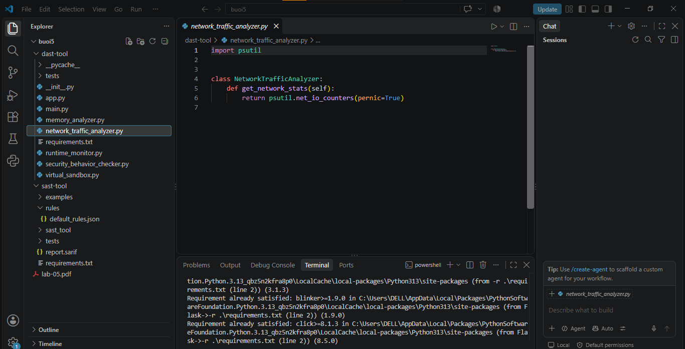

#### d. Module `SecurityBehaviorChecker` (`dast-tool/security_behavior_checker.py`)
Quét các dấu hiệu gọi hàm hệ thống nguy hiểm có thể bị lợi dụng để tấn công RCE (*Remote Code Execution*) hoặc bypass hệ thống như `os.system`, `eval`, `exec`.

> **Hình 15:** Mã nguồn module SecurityBehaviorChecker phát hiện các hàm nhạy cảm.
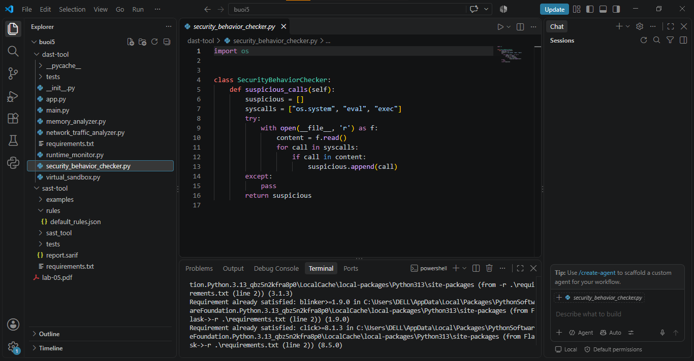

#### e. Module `VirtualSandbox` (`dast-tool/virtual_sandbox.py`)
Cung cấp môi trường cô lập đơn giản bằng cách tạo thư mục tạm (`tempfile.mkdtemp()`) và thực thi lệnh bên trong thư mục này qua `subprocess.run()`, thu thập chuẩn `stdout` và `stderr`.

> **Hình 16:** Mã nguồn module VirtualSandbox cách ly lệnh thực thi.
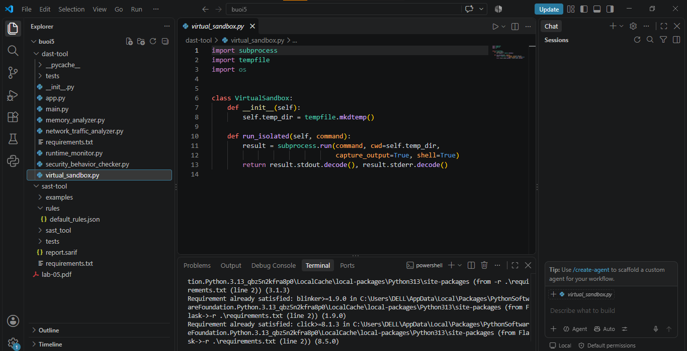

---

### 2.3 Kiểm thử đơn vị (Unit Tests) cho DAST-TOOL
Chạy kiểm thử bộ test suite của DAST:
```powershell
python -m unittest discover -s tests
```

> **Hình 17:** Kết quả chạy Unit Test cho DAST-TOOL: 5/5 test cases đều vượt qua (OK).
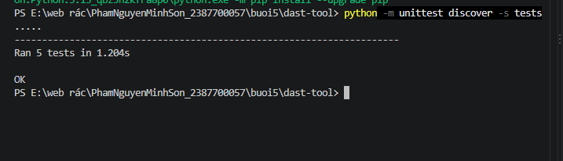

---

### 2.4 Chạy thực nghiệm phân tích động qua Console (`main.py`)
Thực thi script `main.py` để lấy báo cáo trực tiếp thông số của tiến trình hiện tại:
```powershell
python .\main.py
```
* **Kết quả đo lường thực tế:**
  * PID tiến trình: `12544`
  * CPU Usage: `0.0%`
  * Memory Usage: `24,252,416 bytes` (~23.1 MB)
  * Open Files: Hệ thống ghi nhận file `KernelBase.dll.mui`
  * Memory Leaks: `[]` (không có rò rỉ rác bộ nhớ)
  * Overflow Test: `True` (phát hiện giá trị vượt ngưỡng $2^{63}$)
  * Network Stats: Ghi nhận chi tiết các card mạng `Wi-Fi`, `Ethernet`, `VMware Network Adapter`
  * Suspicious Calls: Phát hiện các lời gọi nhạy cảm `['os.system', 'eval', 'exec']`
  * Sandbox: Chạy lệnh `echo Hello Sandbox` thành công và thu được chuỗi đầu ra.

> **Hình 18:** Kết quả thực thi script main.py phân tích toàn diện tiến trình runtime.
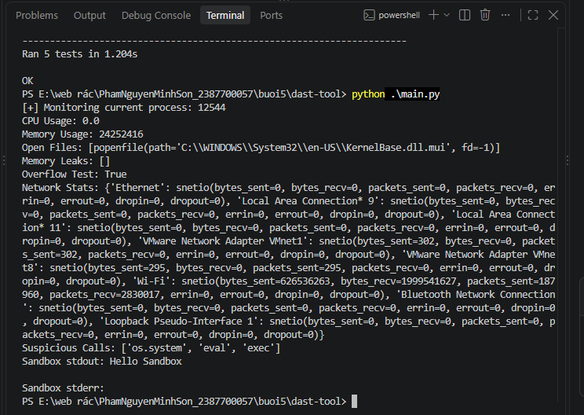

---

### 2.5 Triển khai và kiểm thử dịch vụ giám sát qua Flask API

#### a. Khởi chạy Flask Server (`app.py`)
Dịch vụ chạy tại địa chỉ `http://127.0.0.1:5000`:
```powershell
python .\app.py
```

> **Hình 19:** Khởi chạy Flask Server cung cấp dịch vụ RESTful API.
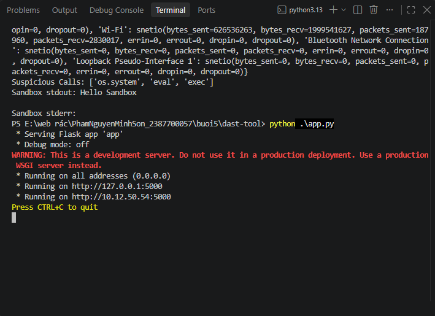

#### b. Kiểm thử các API Endpoints bằng `curl.exe`
Thực hiện gửi yêu cầu HTTP đến các endpoint:
1. `GET /api/monitor`: Lấy thông số CPU, RAM, open files dưới dạng JSON:
   ```json
   {"cpu_usage": 0.0, "memory_usage": 44384256, "open_files": ["...\\KernelBase.dll.mui"]}
   ```
2. `GET /api/network`: Trả về số liệu byte gửi/nhận của tất cả giao tiếp mạng.
3. `GET /api/security`: Báo cáo danh sách hàm nghi vấn `["os.system", "eval", "exec"]`.
4. `POST /api/sandbox`: Gửi payload JSON yêu cầu sandbox thực thi lệnh.

> **Hình 20:** Kết quả gọi và phản hồi từ các API endpoint thông qua curl.exe.
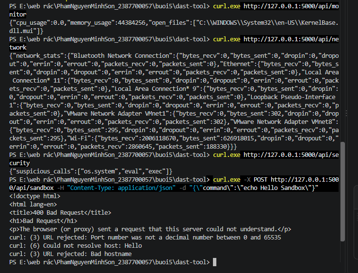

---

# KẾT LUẬN VÀ BÀI HỌC KINH NGHIỆM

1. **Hiệu quả của SAST:**
   * Cho phép phát hiện lỗi từ rất sớm ngay trong quá trình viết mã (Shift-Left Security).
   * Phân tích AST và Regex giúp định vị chính xác vị trí dòng code có lỗ hổng (như dùng `eval()`, để lộ mật khẩu, import thư viện nguy hiểm).
   * Việc xuất báo cáo chuẩn SARIF giúp dễ dàng tích hợp vào quy trình CI/CD và hiển thị trực quan trong các IDE hiện đại.

2. **Hiệu quả của DAST:**
   * Cung cấp góc nhìn thực tế về hành vi ứng dụng khi chạy trên hệ điều hành.
   * Giám sát chính xác lượng tài nguyên tiêu thụ, phát hiện sớm các hiện tượng rò rỉ bộ nhớ hoặc bùng nổ tài nguyên.
   * Cung cấp môi trường Sandbox an toàn để cô lập các tác vụ rủi ro cao.

3. **Tổng kết:**
   Cả hai phương pháp kiểm thử SAST và DAST bổ trợ lẫn nhau, tạo nên bức tường bảo mật toàn diện từ giai đoạn phát triển mã nguồn đến môi trường vận hành thực tế.
